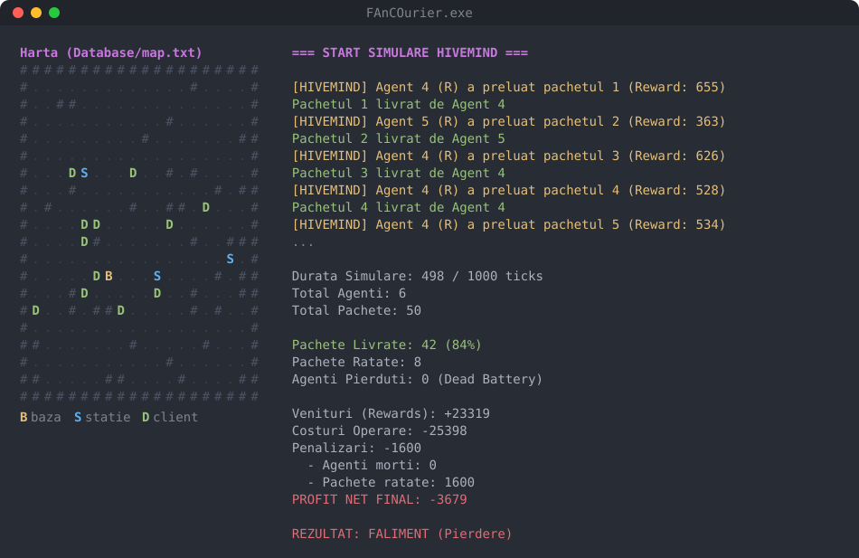

# FAnCOurier

[](https://github.com/tankistkebab/FAnCOurier/actions/workflows/ci.yml)


A tick-based **last-mile delivery simulator** in modern C++. A central dispatcher (the *HiveMind*) runs a mixed fleet of drones, robots and scooters across a city grid. It assigns packages to couriers, plans routes with **A\***, and sends agents to recharge before their batteries run out. The goal is to deliver as many packages as possible before their deadlines while keeping the operation profitable.



> The console UI and the code comments are in Romanian. This README is in English.

## Features

- **Two map sources**, interchangeable through the Strategy pattern (`IMapGenerator`):
  - `FileMapLoader` reads a hand-made ASCII map and validates its structure.
  - `ProceduralMapGenerator` carves a maze with a randomized depth-first backtracker, knocks down extra walls to add alternate routes, then places the base, charging stations and clients on reachable cells.
- **Map validation**: a BFS integrity check guarantees that every client and charging station can be reached from the base.
- **A\* pathfinding** with a Manhattan heuristic. Ground units go around walls, and drones fly over them.
- **Heterogeneous fleet** with different trade-offs:

  | Agent   | Movement | Speed | Battery | Drain/tick | Cost/tick | Capacity |
  |---------|----------|------:|--------:|-----------:|----------:|---------:|
  | Drone   | air      | 3     | 100     | 10         | 15        | 1        |
  | Scooter | ground   | 2     | 200     | 5          | 4         | 2        |
  | Robot   | ground   | 1     | 300     | 2          | 1         | 4        |

- **HiveMind dispatcher**: on every tick each idle agent bids on each pending package. A bid's score is the estimated profit (reward minus operating cost), with a bonus for urgent deliveries and a penalty for using expensive drones on non-urgent ones. Bids that would miss the deadline or drain the battery are dropped, and the best bids are then assigned greedily.
- **Battery safety**: before letting an agent continue, the dispatcher checks that it can finish its current job *and* still reach a charging station afterwards. If not, it reroutes the agent to recharge.
- **Final report** (`simulation.txt`): deliveries, missed packages, lost agents, revenue, operating costs, penalties and net profit.

## Architecture

```
main.cpp                 Interactive menu (load map / generate map / exit)
SimManager   (singleton) Loads config, builds the map, owns the fleet & packages, runs the tick loop
 ├─ IMapGenerator        Strategy interface
 │   ├─ FileMapLoader
 │   └─ ProceduralMapGenerator
 ├─ Map                  Grid + cached points of interest + BFS integrity check
 ├─ HiveMind             Deadlines, deliveries, battery checks, task bidding & assignment
 ├─ Pathfinder           A* (ground vs. air movement)
 └─ Agent                Base class: movement, battery, charging state machine
     └─ Drone / Robot / Scooter
```

Each tick: spawn a package (if due) → `HiveMind::update` → `Agent::update` for every agent → stop early once all packages are resolved.

## Build & run

Requires CMake ≥ 3.20 and a C++20 compiler (GCC, Clang, MSVC or MinGW).

```bash
cmake -S . -B build -DCMAKE_BUILD_TYPE=Release
cmake --build build

cd build              # data paths are resolved relative to the build directory
./FAnCOurier          # pick 1 (map from file) or 2 (procedural map)
```

The final report is written to `simulation.txt` in the repository root.

### Configuration

`Database/simulation_setup.txt` controls the simulation:

```
Plaintext
MAP_SIZE: 20 20
MAX_TICKS: 1000
MAX_STATIONS: 3
CLIENTS_COUNT: 12

DRONES: 3
ROBOTS: 2
SCOOTERS: 1

TOTAL_PACKAGES: 50
SPAWN_FREQUENCY: 10
```

`Database/map.txt` is the hand-made map: `#` wall, `.` road, `B` base, `S` charging station, `D` client, `X` empty space.

## Tests

Unit tests use [GoogleTest](https://github.com/google/googletest), which CMake downloads automatically:

```bash
ctest --test-dir build --output-on-failure
```

They cover map parsing and its error cases, the BFS integrity check, procedural generation (border, object counts, validity across repeated runs), A\* (shortest ground path, drones flying over walls, unreachable targets), agent movement, battery drain, death and recharging, and the HiveMind's assignment, delivery, expiry and cost-aware agent choice.

CI builds and tests on Ubuntu (GCC and Clang) and Windows (MSVC) on every push, and runs a smoke simulation.

## Project structure

```
Headers/            Public headers (Map_Building/ holds the map subsystem)
Logic/              Implementations
Database/           Simulation config and the hand-made map
tests/              GoogleTest suite
docs/               README assets
.github/workflows/  CI pipeline
```

## Possible improvements

- Use exception types instead of integer error codes.
- Store the fleet in `std::unique_ptr<Agent>` instead of raw owning pointers.
- Add a `--quiet` flag or log levels; the current debug output is verbose.
- Tune the bidding economics: with the default config the fleet delivers about 85% of packages but still runs at a loss.
- Simulate traffic, which is the original reason for choosing A* over plain BFS/Dijkstra.
